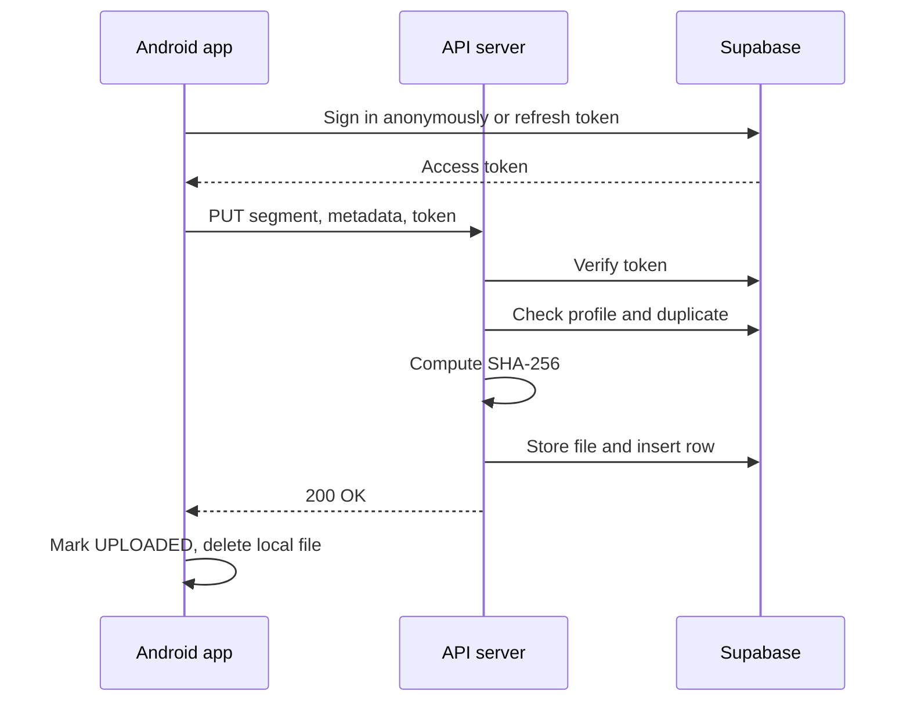

# Martyra Phase 2: Final Flow (server and Supabase)

The app's capture, sealing and local queue are unchanged (`final_flow.md`). This file covers what happens from the moment a sealed file leaves the phone.

---

## 1. One-time setup (human)

1. Create a Supabase project and enable anonymous sign-ins.
2. Run `supabase/schema.sql` in the SQL Editor.
3. Put the secret key and project URL in `server/.env`; put the project URL and publishable key in the Android `local.properties`.
4. For development: start the server, then `adb reverse tcp:3000 tcp:3000` with the phone on USB.

## 2. First launch (unchanged, works offline)

The user enters a name and grants permissions. The name is saved on the phone. Nothing is sent anywhere yet, so this works with no network.

## 3. Upload job (on the phone)

1. Runs whenever the network is available, one at a time. It ingests new `.enc` files into the encrypted database, as before.
2. **Token:** if the app has no access token, it signs in anonymously with Supabase Auth (first time) or refreshes with its stored refresh token. Done silently.
3. For each row below UPLOADED, oldest first: status SYNCING, decrypt in memory, send to the server (section 4).
4. Server answered **200:** status UPLOADED, local file deleted, row kept as history.
   Anything else (server down, timeout, 401, 403, 409, 5xx): file and row are kept. Retry with linear 15-second backoff.

## 4. Server pipeline (`PUT /v1/evidence/:session/:seq`)

1. **Verify token** with Supabase Auth. Invalid: 401. This happens before the body is read.
2. **Validate** the path, query and body. Invalid: 400. Too large: 413.
3. **Profile:** create it from the name if it does not exist. If the user is disabled: 403.
4. **Duplicate check:** same session and sequence already stored? Same claimed hash: answer 200 `duplicate` and change nothing. Different hash: 409.
5. **Hash:** compute SHA-256 of the received bytes. This is the real fingerprint.
6. **Store** the file in the private bucket at `{user_id}/{session}/{seq}.{ext}`.
7. **Insert** the evidence row: server hash, the app's claimed hash, size, device, location, captured time, received time, status 2.
8. Answer **200** with `hash_ok`. If the hashes differ, the evidence is kept and flagged, never dropped.

## 5. What is stored where

| Place | Holds |
|---|---|
| Supabase Auth | Users (anonymous accounts) |
| `profiles` | User ID, name, disabled flag |
| `evidence` | One row per segment or photo: path, session, sequence, times, location, device, server hash, claimed hash, `hash_ok`, size, status |
| Storage bucket `evidence` | The video and photo files, private |
| `evidence_sessions` (view) | Per session: segments, bytes, start time, all hashes matched, status |

Status numbers (shared with the app): 2 received, 3 anchored, 4 confirmed. They only move forward. Anchoring (3 and 4) is built in a later phase.

## 6. Who can do what

| Who | Can |
|---|---|
| The app | Sign in, call the server. It never touches Storage or the database directly |
| A user token | Read only that user's own rows |
| The server (secret key) | Write profiles, files and evidence rows |
| An admin | Read everything: all rows, the sessions view and all files (through short-lived signed links) |

## 7. When something goes wrong

| Situation | What happens |
|---|---|
| Server not running or unreachable | Files stay encrypted on the phone; retried every few minutes until it is back |
| No network | Same; uploads start when it returns |
| Access token expired | The app refreshes it; on a 401 it discards the token and retries |
| User disabled by an admin | Server answers 403; the app keeps the files and keeps retrying |
| Same segment sent twice | Server answers 200; nothing is duplicated or overwritten |
| Fingerprint differs from the app's claim | Stored and flagged `hash_ok = false` |
| Crash between the file upload and the row insert | The retry completes it (the upload overwrites the same file, then the row is inserted) |
| Supabase unreachable | Server answers 500; the app retries |
| App data cleared | A new anonymous user is created; earlier uploads stay under the old user |

## 8. The viewer, later (nothing to change in the backend)

An admin signs in on a web page with email and password, sees all users and their sessions, picks a session, and the page plays its segments one after another from signed links. For each segment it recomputes the SHA-256 in the browser and compares it with the stored one, then shows the status.

## 9. Diagram

